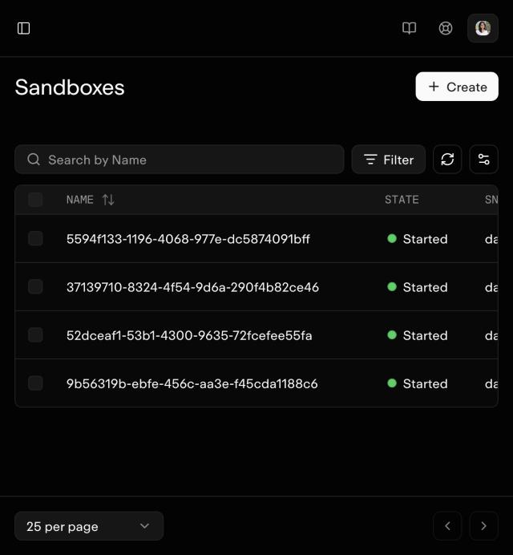
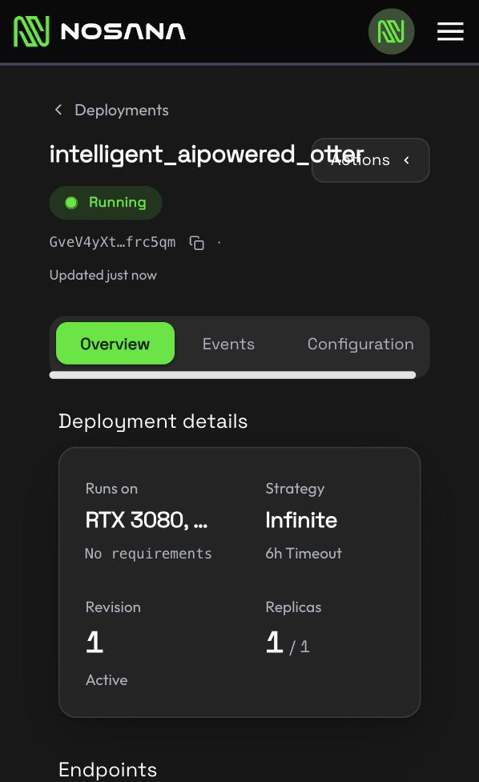

# 🛡️ PatchPilot

**Find what's exploitable. Fix it. Prove the fix.**

PatchPilot is an AI security engineer. Paste any GitHub repo and it:
1. clones the code into a throwaway **Daytona** sandbox,
2. reads the project's **DeepWiki** docs (via **Tavily**) to understand the architecture and attack surface,
3. hunts with two parallel sub-agents: **Threat Intel** (OSV + FIRST EPSS + CISA KEV + live security news via Tavily) and
   **Code Review** (a PHP/Go/JS/Python pattern hunter + bandit, triaged by an LLM),
4. **fixes** vulnerable dependencies with an agent loop on an open model running on **Nosana** GPUs,
5. **proves** the fix by re-installing, re-scanning and re-running the tests in the sandbox, then writes a plain-English report:
   🔴 **Critical** · 🟠 **Needs a patch** · 🔵 **Monitor**.

> AI review tools *comment* on code. PatchPilot *executes* its claims.

Built at **Tokyo AgentForge · 14 Nov 2026**.

---

## Screenshots

| PatchPilot landing + live architecture | Plain-English security report |
|---|---|
|  |  |

| Daytona: 4 sandboxes scanning 4 repos in parallel | Nosana: our dedicated GPU (RTX 3080 · $0.10/h) | Tavily: API usage |
|---|---|---|
|  |  |  |

---

## Architecture

```
 GitHub URL
     │
     ▼
┌──────────────────── ① Daytona sandbox (1 vCPU · 1 GB RAM · 3 GB disk · ~1 s boot) ────────────────────┐
│  git clone ─▶ ② RECON ─────────▶ ③ HUNT ─────────────────────────┬──▶ ④ FIX ───────────▶ ⑤ PROVE      │
│               Tavily extract     ├ Threat Intel sub-agent ─┐     │    Nosana Qwen agent     re-install  │
│               → DeepWiki docs    │  OSV · EPSS · CISA KEV  ├─▶ merge   loop: run · read ·   re-scan     │
│                                  │  Tavily news & forums   │          write · web_search   re-test     │
│                                  └ Code Review sub-agent ──┘          · finish             git diff    │
│                                     pattern hunter · bandit → Nosana LLM triage              │
└────────────────────────────────────────────────────────────────────────────────────────────────────────┘
     │
     ▼
 Report: 🔴 Critical / 🟠 Needs a patch / 🔵 Monitor  (+ diff & PR text when auto-patched)
```

| Stage | What it does (plain English) | Partner | Why this partner is special here |
|---|---|---|---|
| ① Sandbox | A throwaway computer where the untrusted repo and every AI-chosen command run | **Daytona** | ~1 s cold start, full Linux with git and network, SDK for `process.exec`, `fs`, `git`. We run 4 repos in 4 sandboxes at once and delete them afterwards |
| ② Recon | Reads the docs first, like a senior engineer | **Tavily → DeepWiki** | `tav.extract(["https://deepwiki.com/owner/repo"])` returns clean, LLM-ready architecture docs for any public repo |
| ③ Hunt | Finds vulnerable libraries and dangerous code, ranked by real-world risk | OSV · FIRST EPSS · CISA KEV · **Tavily** search/news | EPSS = probability of exploitation in the next 30 days, which spots what will hurt *before* it's headline news |
| ④ Fix | Upgrades libraries and repairs code the upgrade broke | **Nosana** | Open model on decentralized GPUs: OpenAI-compatible gateway, **plus** our own dedicated GPU deployment with automatic failover and live credit tracking |
| ⑤ Prove | Re-installs, re-scans and re-tests, then shows the diff | **Daytona** | Same isolated machine, so the evidence is reproducible |

## Case studies (real runs, saved in `cases/`)

| Repo | Stack | Result |
|---|---|---|
| demo `invoice-mailer` | Python | **20 → 0** dependency advisories, auto-patched. The agent fixed Jinja2 3.1's removed `Markup`/`escape` and tests passed 3/3 ✅. It also flagged a hard-coded key, pickle RCE, `shell=True` and `verify=False` |
| [Agent-Field/CodeAF](https://github.com/Agent-Field/CodeAF) | Go | 🟠 81 s: DeepWiki recon of the harness; 110 Go modules → 22 advisories in `golang.org/x/net`, `x/crypto`, `x/image` (ranked by EPSS/KEV); code review flagged a shell-injection-prone path in a CI helper |
| [digininja/DVWA](https://github.com/digininja/DVWA) | PHP | **🔴 9 critical in 61 s**: OS command injection (`shell_exec('ping ' . $target)`), SQL injection in login / password update, local file inclusion; each with a concrete fix (`escapeshellarg`, PDO prepared statements, allow-lists). Open it at `/#case=DVWA` |
| [OWASP/NodeGoat](https://github.com/OWASP/NodeGoat) | Node.js | 🔴 91 s: 804 npm packages → 177 advisories (top EPSS: `decode-uri-component`, `lodash`, `qs`); **`eval()` remote code execution** in `contributions.js` |

## PHP-specific checks
`eval`/`assert` on input · `system`/`exec`/`shell_exec`/`passthru`/backticks · `include`/`require` of `$_GET` (LFI/RFI) ·
`unserialize` (object injection) · SQL concatenated from `$_GET`/`$_POST` · `echo $_GET` (XSS) · MD5 passwords ·
LLM triage briefed on php-cgi argument injection (CVE-2024-4577 class) and type juggling.
Composer dependencies are checked against OSV's Packagist feed.

## How an AI agent + sandbox work (60-second version)
1. **An agent is a loop, not a model:** think → call a tool → read the result → repeat (`for step in range(MAX_STEPS)` in `agent.py`).
2. **Tools are JSON schemas.** The model only *asks* to `run`, `read_file`, `write_file`, `web_search` or `finish`, and our code executes it inside Daytona. A required `thought` argument makes the reasoning visible.
3. **Sub-agents are specialists** with their own tools and prompts. Threat Intel and Code Review run in parallel threads.
4. **Never trust "done".** Prove ignores the model's claim and re-checks everything itself.

## Run it
```bash
cd proofpilot
python3 -m venv .venv && .venv/bin/pip install -r requirements.txt
cp .env.example .env        # DAYTONA_API_KEY, NOSANA_API_KEY, TAVILY_API_KEY (+ optional NOSANA_DEPLOYMENT_URL)
.venv/bin/uvicorn server:app --port 8000      # open http://localhost:8000
```

## Usage manual
- **Run a test:** paste a public GitHub URL (or leave it empty for the demo), then click **Run security test**. The page switches to the live view.
- **Read the report:** verdict line first, then the 3 buckets. Every item says *what it means* in everyday words and *how to fix it*.
  **EPSS %** = chance of an attack in the next 30 days · **EXPLOITED IN THE WILD** = listed in CISA's KEV catalog.
- **Share it:** **Download report (.md)** or **Print / save PDF**.
- **Hover the diagram** to see what each partner does, with live numbers (sandbox size, tokens, cost, Nosana credits left).
- **Case studies:** click any card to open its saved report.

## Files
`agent.py` orchestrator + fixer loop + Nosana routing · `security.py` recon / threat-intel / code-review sub-agents + report ·
`scanners.py` lockfile parsers, pattern hunter, bandit · `server.py` FastAPI, SSE stream, compute telemetry, case studies ·
`static/index.html` the site · `demo_repo/` intentionally vulnerable target · `cases/` saved reports · `docs/` screenshots.

**Safety:** scanned code only ever runs inside Daytona; sandboxes are deleted after each run. Secrets in `demo_repo` are fake.
