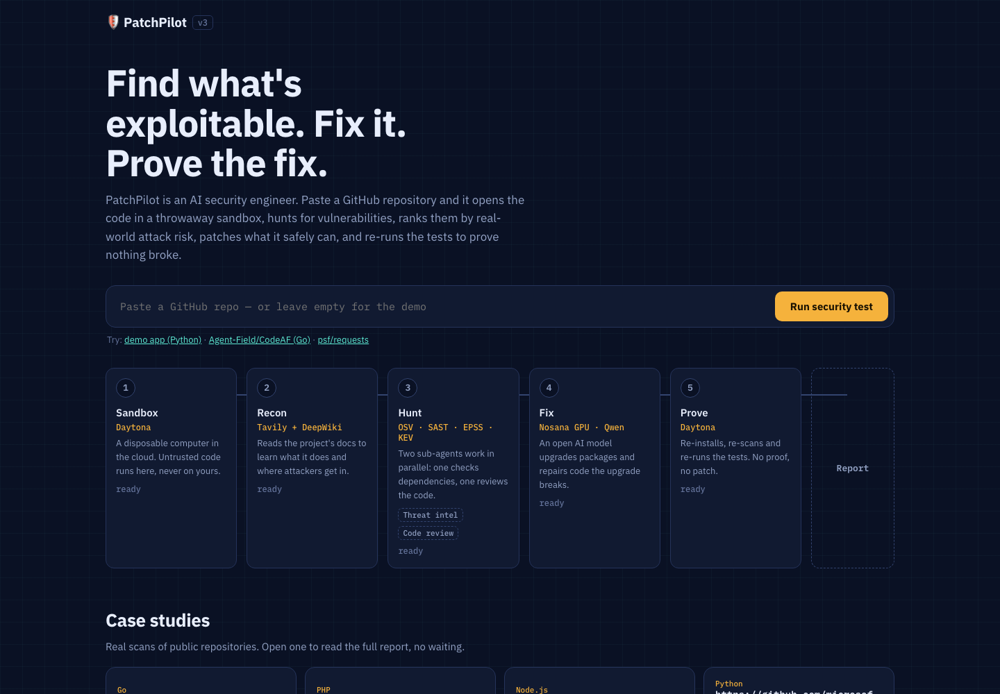
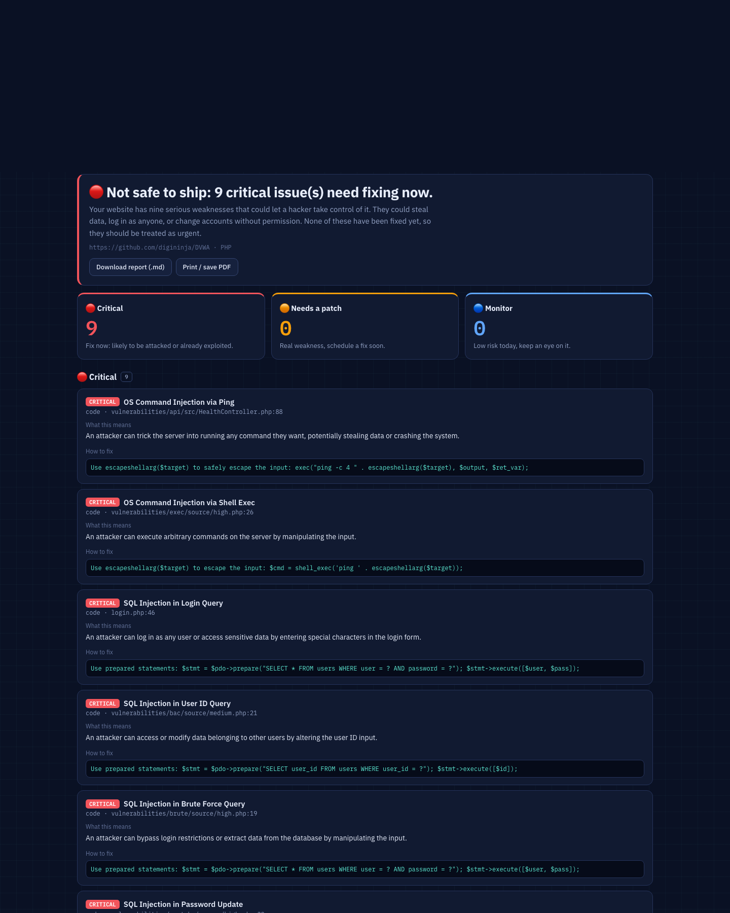
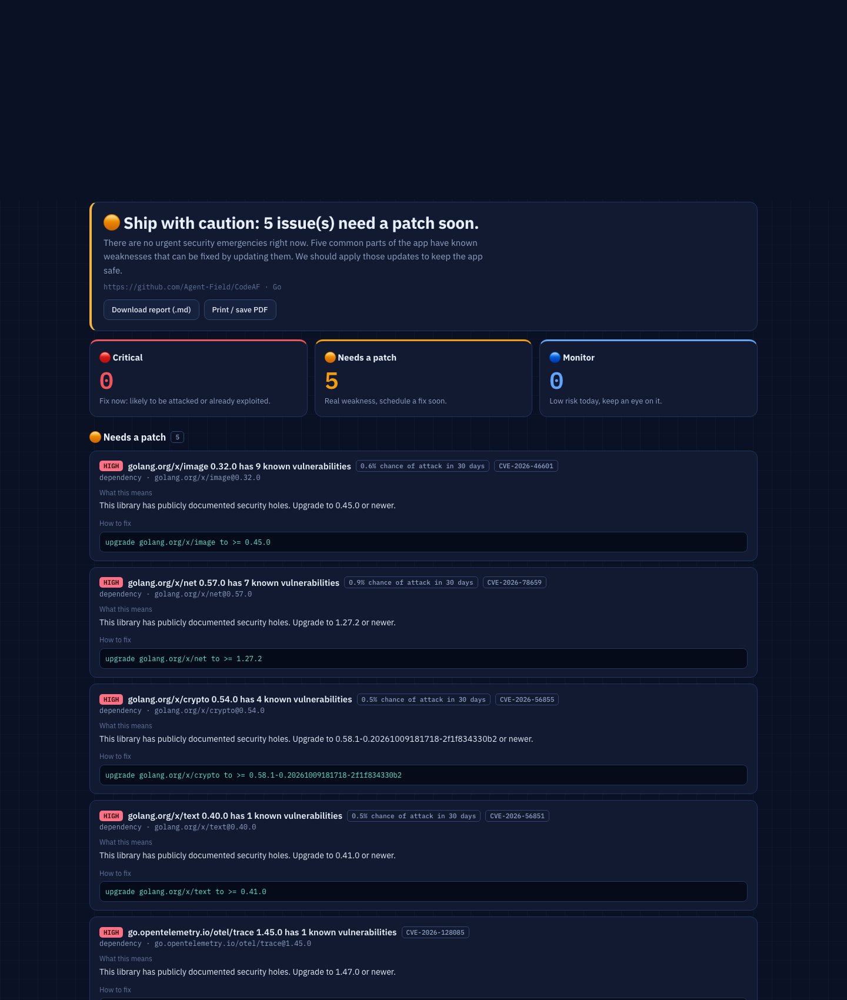
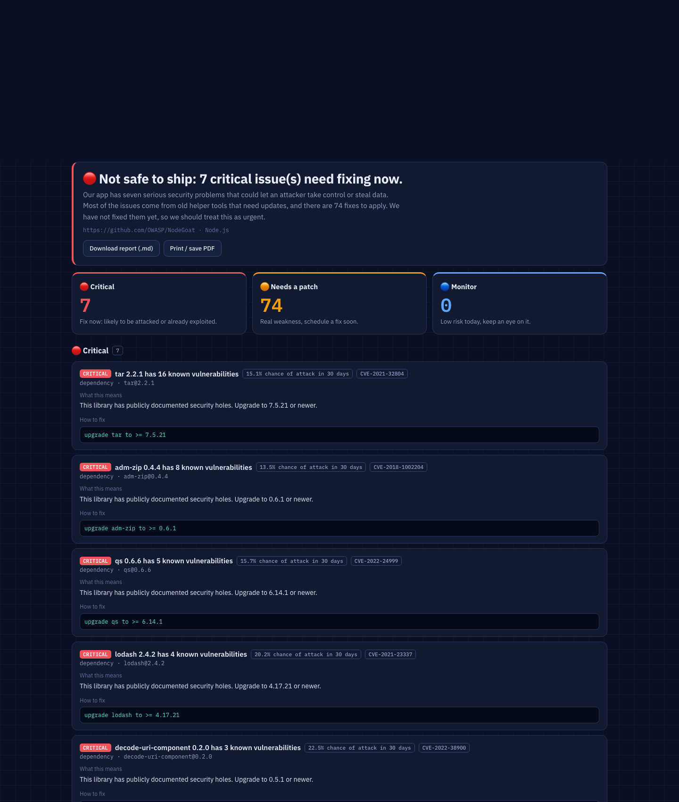
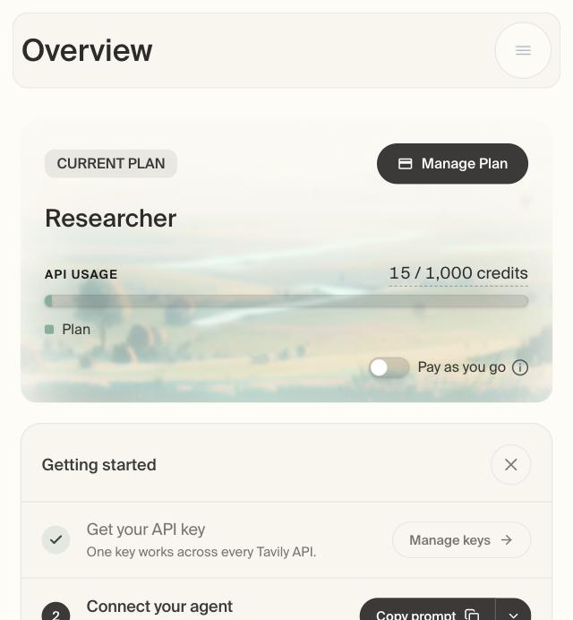

<div align="center">

# 🛡️ PatchPilot
**The AI security engineer that proves its fixes.**

Paste a GitHub repo → find what's exploitable → fix it → prove the fix → plain-English report.

Built at **Tokyo AgentForge 2026** with **Daytona · Nosana · Tavily**

**[📑 Pitch deck (PDF)](docs/PatchPilot-deck.pdf)** · **[📊 Results](#-results-on-real-repos)** · **[🚀 Run it](#-run-it)**



</div>

## 💡 The problem
Most breaches start with a **known** bug. Teams don't patch because they can't tell what's actually exploitable, and upgrades break code. AI review bots *comment*; **PatchPilot executes** every fix and proves it.

## 📊 Results on real repos
| Repository | Stack | Verdict | Key finding | Time |
|:--|:--:|:--:|:--|:--:|
| [Agent-Field/CodeAF](https://github.com/Agent-Field/CodeAF) | Go | 🟠 | 22 known vulns across 110 modules (`x/net`, `x/crypto`, `x/image`) | 81 s |
| [digininja/DVWA](https://github.com/digininja/DVWA) | PHP | 🔴 | 9 critical: command injection, SQL injection, file inclusion, all with fixes | 61 s |
| [OWASP/NodeGoat](https://github.com/OWASP/NodeGoat) | Node | 🔴 | `eval()` remote code execution + 177 known vulns | 91 s |
| [microsoft/generative-ai-for-beginners](https://github.com/microsoft/generative-ai-for-beginners) | Python | 🟢 | Clean: 66 deps, no known vulns | 106 s |
| `demo_repo` | Python | ✅ | **Auto-patched 20 → 0**, fixed the Jinja2 break, tests 3/3 | ~110 s |

<p align="center">Cost per scan: <b>$0.002–0.013</b> · Full reports in <a href="cases/"><code>cases/</code></a></p>

| 🔴 DVWA (PHP) | 🟠 CodeAF (Go) |
|:--:|:--:|
|  |  |
| 🔴 **NodeGoat (Node)** | 🟢 **Microsoft repo** |
|  |  |

## ⚙️ How it works
| Step | What happens | Powered by |
|:--:|:--|:--|
| ① Sandbox | Disposable VM (boots ~1 s); untrusted code never touches your laptop | **Daytona** |
| ② Recon | Reads the repo's architecture and attack surface first | **Tavily** → DeepWiki |
| ③ Hunt | Two parallel sub-agents: Threat Intel (OSV · EPSS · CISA KEV · news) + Code Review | OSV · FIRST · CISA · **Tavily** |
| ④ Fix | Agent loop: think → run a tool in the sandbox → observe → repeat | **Nosana** (Qwen) |
| ⑤ Prove | Re-install, re-scan, re-test → diff, PR text, report | **Daytona** |

## 🤝 Partner tech (code-level)
- **Daytona:** `create` · `process.exec` · `git.clone` · `fs` · `delete`; 4 repos scanned in 4 sandboxes at once.
- **Nosana:** OpenAI-compatible gateway (Qwen 3.8 27B, tool calling) **+** our own RTX 3080 GPU (Qwen 3.5 9B, $0.10/h) with auto-failover and live credit tracking.
- **Tavily:** `extract` (DeepWiki recon) · `search` with answers (fix research) · news/forum search (threat intel).

| Daytona sandboxes | Nosana GPU | Tavily usage |
|:--:|:--:|:--:|
|  |  |  |

## 🚀 Run it
```bash
git clone https://github.com/Ana2k/patch-pilot && cd patch-pilot
python3 -m venv .venv && .venv/bin/pip install -r requirements.txt
cp .env.example .env        # DAYTONA_API_KEY, NOSANA_API_KEY, TAVILY_API_KEY
.venv/bin/uvicorn server:app --port 8000
```
Open `http://localhost:8000`, paste a repo (or leave empty for the demo). Saved reports: `/#case=DVWA`.

<sub>`agent.py` orchestrator + fixer · `security.py` sub-agents + report · `scanners.py` PHP/Go/JS/Python checks · `server.py` API · `static/` site · `demo_repo/` fake secrets only. Scanned code runs only inside Daytona.</sub>
