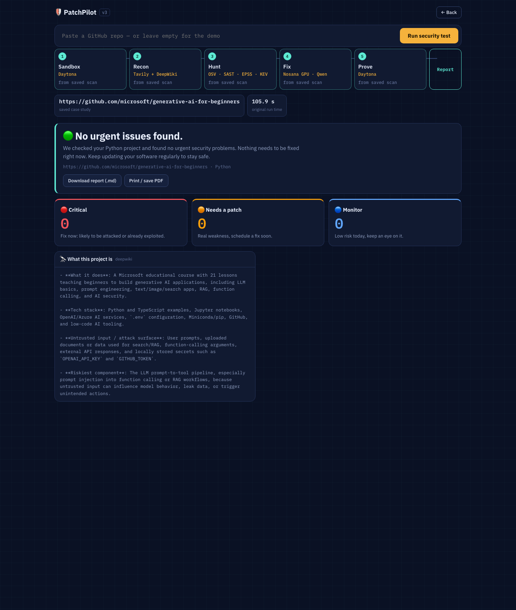

<div align="center">

# 🛡️ PatchPilot
### The AI security engineer that **proves** its fixes

**Paste a GitHub repo → find what's exploitable → fix it → prove the fix → get a report anyone can read.**

Built in one afternoon at **Tokyo AgentForge · 14 Nov 2026** with **Daytona · Nosana · Tavily**

📑 [Pitch deck (PDF)](docs/PatchPilot-deck-9slides.pdf) · 🖥️ [Run it](#-run-it-in-2-minutes) · 📊 [Real results](#-real-results-on-real-repos)


</div>

---

## 💡 Why this matters
- Most breaches start with a **known** vulnerability: an old library or a classic injection bug.
- Teams don't patch because they **can't tell what's actually exploitable**, and **upgrades break code**.
- AI review bots **comment** on code. Nobody **runs** the fix to prove it works.

**PatchPilot runs everything.** Every claim in its report is backed by commands it actually executed in an isolated sandbox.

---

## 📊 Real results on real repos
| # | Repository | Stack | Verdict | What PatchPilot found | Time |
|---|---|---|---|---|---|
| 1 | [Agent-Field/CodeAF](https://github.com/Agent-Field/CodeAF) | Go | 🟠 Needs patches | Read the DeepWiki architecture first, then scanned 110 Go modules → **22 known vulnerabilities** in `golang.org/x/net`, `x/crypto`, `x/image`, ranked by real-world exploit odds; flagged a shell-injection-prone CI helper | 81 s |
| 2 | [digininja/DVWA](https://github.com/digininja/DVWA) | PHP | 🔴 Not safe to ship | **9 critical**: OS command injection (`shell_exec('ping ' . $target)`), SQL injection in login and password update, local file inclusion, each with a working fix (`escapeshellarg`, PDO prepared statements, allow-lists) | 61 s |
| 3 | [OWASP/NodeGoat](https://github.com/OWASP/NodeGoat) | Node.js | 🔴 Not safe to ship | **`eval()` remote code execution** in `contributions.js` + **177 known vulnerabilities** across 804 npm packages | 91 s |
| 4 | [microsoft/generative-ai-for-beginners](https://github.com/microsoft/generative-ai-for-beginners) | Python | 🟢 Clean | 66 dependencies, 0 known vulnerabilities, no risky code patterns | 106 s |
| 5 | `demo_repo` (invoice-mailer) | Python | ✅ **Auto-patched** | **20 → 0** vulnerabilities; the upgrade broke Jinja2 (`Markup`/`escape` removed), the agent found and fixed it, **tests 3/3 green** | ~110 s |

Average cost per scan: **$0.002–0.013** of inference on Nosana. Full JSON reports are in [`cases/`](cases/).

### 🔍 The reports
| 🔴 DVWA (PHP): 9 critical injections | 🟠 CodeAF (Go): dependency risk |
|---|---|
|  |  |
| 🔴 **NodeGoat (Node): eval() RCE + 177 CVEs** | 🟢 **Microsoft repo: clean bill of health** |
|  |  |

---

## ⚙️ How it works: 5 steps
```
 GitHub URL
    │
 ① SANDBOX ── Daytona: a fresh, disposable Linux VM (1 vCPU · 1 GB · boots in ~1 s). Nothing runs on your laptop.
    │
 ② RECON ──── Tavily extract → DeepWiki: read the project's architecture and attack surface first
    │
 ③ HUNT ───── two sub-agents in parallel
    │           ├─ Threat Intel: OSV vulnerability DB + FIRST EPSS (odds of attack in 30 days) + CISA KEV (exploited in the wild) + Tavily security news
    │           └─ Code Review: pattern hunter (PHP · Go · JS · Python) + bandit → LLM triage on Nosana
    │
 ④ FIX ────── Nosana-hosted Qwen agent loop: think → run a tool in the sandbox → read the result → repeat
    │
 ⑤ PROVE ──── re-install, re-scan, re-run tests in the same sandbox → diff + PR text
    │
 📄 REPORT ── 🔴 Critical · 🟠 Needs a patch · 🔵 Monitor, written for non-engineers
```

## 🤝 How each partner is used (code-level)
| Partner | What we use | Why it's the right tool here |
|---|---|---|
| **Daytona** | `Daytona.create()`, `process.exec()`, `git.clone()`, `fs.upload_files()`, `fs.download_file()`, `delete()` | Untrusted code + AI-chosen shell commands **must** run isolated. Sandboxes boot in about 1 s, so we scanned **4 repos in 4 sandboxes at once** and threw them away afterwards |
| **Nosana** | OpenAI-compatible inference gateway (Qwen 3.8 27B, function calling) **+** our own GPU deployment (Qwen 3.5 9B on an RTX 3080, $0.10/h) with automatic failover; live credits via `api.nosana.com/api/credits/balance` | Open models on decentralized GPUs keep each scan at fractions of a cent, and failover kept the demo alive when the shared gateway went down mid-hackathon |
| **Tavily** | `extract()` on `deepwiki.com/<owner>/<repo>` · `search(include_answer=True)` · `search(topic="news")` + security-forum domains | Turns docs, changelogs and security chatter into LLM-ready text with sources. Fresh knowledge an LLM's frozen weights don't have |

| Daytona: 4 sandboxes scanning in parallel | Nosana: our dedicated GPU | Tavily: API usage |
|---|---|---|
|  |  |  |

---

## 🐘 PHP-specific checks
Command injection (`system`/`exec`/`shell_exec`/`passthru`/backticks, including via variables) · SQL built from variables · `include`/`require` of user input (LFI/RFI) · `eval`/`assert` · `unserialize` · unsafe uploads · `echo $_GET` (XSS) · MD5 passwords · triage briefed on php-cgi argument injection (CVE-2024-4577 class) and type juggling.

## 🧠 What is an "agent + sandbox"? (for non-engineers)
1. **An agent is a loop:** the AI thinks, picks one tool (run a command, read a file, search the web), sees the result, and repeats.
2. **The sandbox is a disposable computer** where that loop can safely run commands on code nobody has vetted.
3. **Sub-agents are specialists** working in parallel, like a security team.
4. **Never trust "done":** PatchPilot re-checks everything itself before it calls a fix verified.

---

## 🚀 Run it in 2 minutes
```bash
git clone https://github.com/Ana2k/patch-pilot && cd patch-pilot
python3 -m venv .venv && .venv/bin/pip install -r requirements.txt
cp .env.example .env    # add DAYTONA_API_KEY, NOSANA_API_KEY, TAVILY_API_KEY
.venv/bin/uvicorn server:app --port 8000      # open http://localhost:8000
```
Leave the box empty for the demo, or paste any public GitHub repo. Open a saved report directly with `http://localhost:8000/#case=DVWA`.

## 🗂️ Repo map
| File | What it is |
|---|---|
| `agent.py` | Orchestrator, fixer agent loop, Nosana routing + failover |
| `security.py` | Recon / Threat Intel / Code Review sub-agents + plain-English report |
| `scanners.py` | Lockfile parsers (pip, Go, Composer, npm), pattern hunter, bandit |
| `server.py` | FastAPI + live event stream + compute telemetry + case studies |
| `static/index.html` | The website |
| `cases/` | Saved reports · `docs/` deck + screenshots · `demo_repo/` intentionally vulnerable app (fake secrets) |

🔒 Scanned code only ever runs inside Daytona; sandboxes are deleted after every run.
